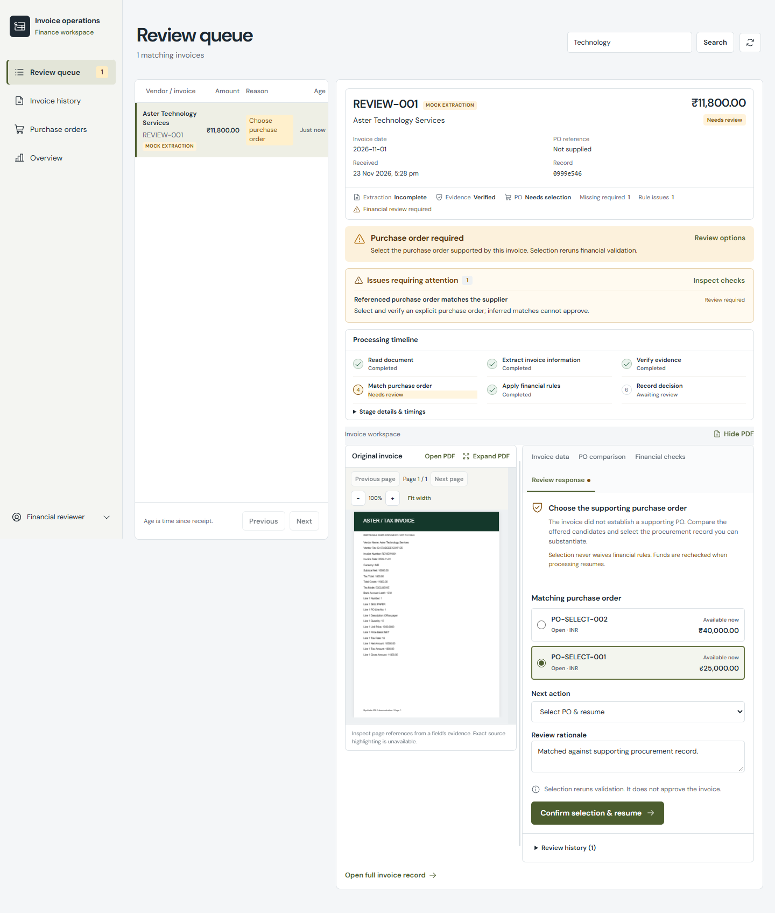
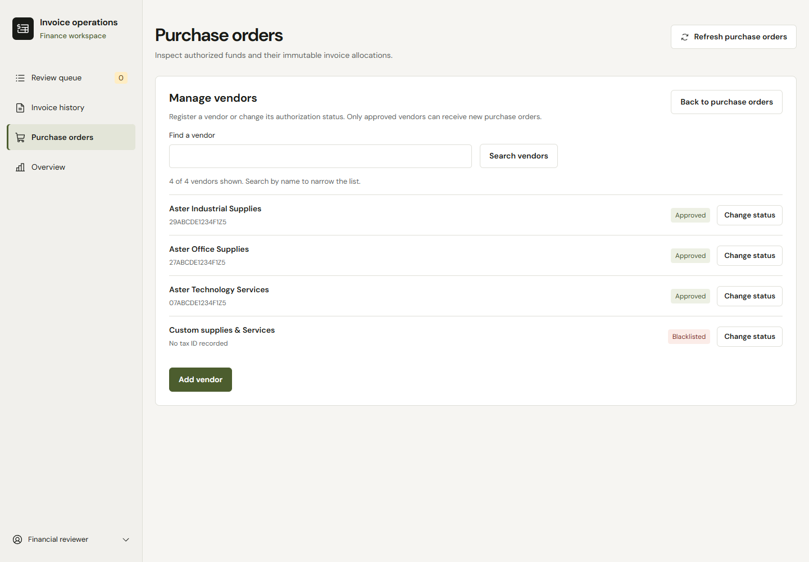
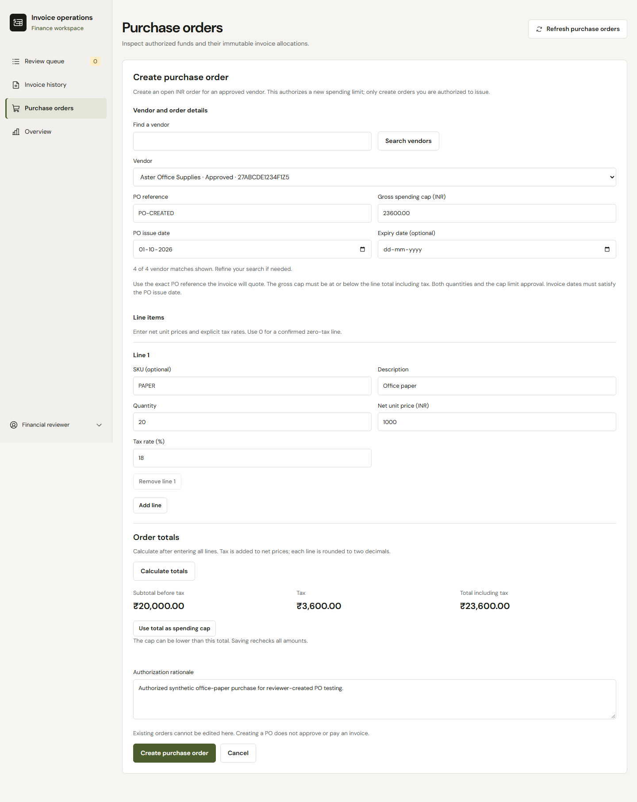
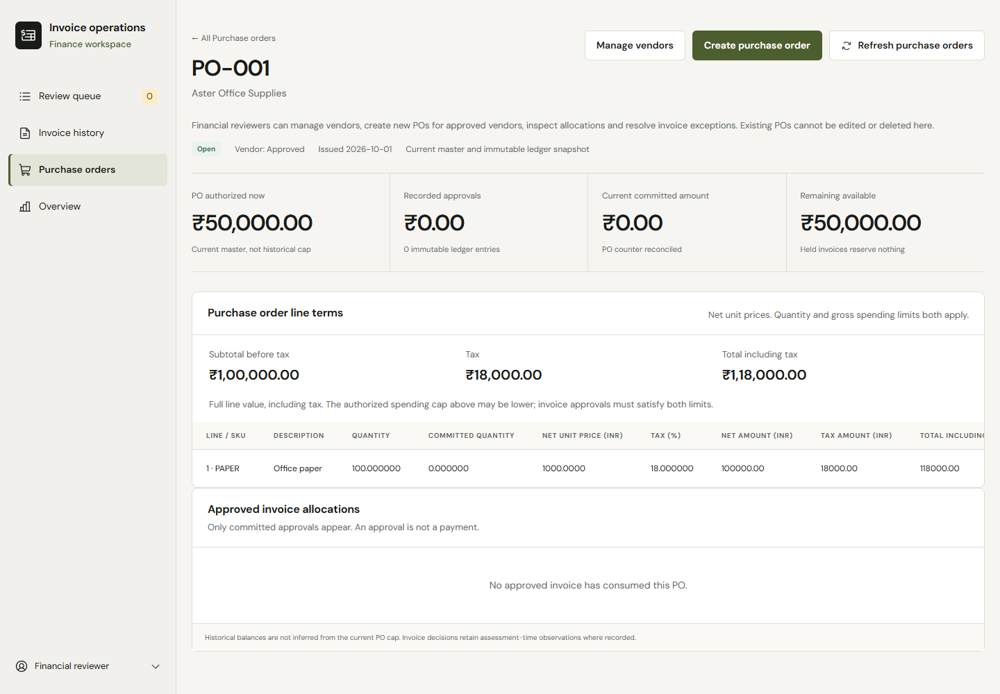
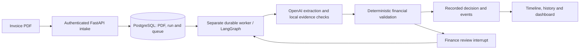

# PS-1 Invoice Automation

A working accounts-payable workflow built for the Zamp AI Solutions Associate case study. It accepts invoice PDFs, extracts their contents with OpenAI, checks source evidence and purchase-order terms, and records a reasoned **Approved**, **Needs review** or **Rejected** outcome. Submitters follow their invoices; finance resolves exceptions and sees how approvals consume a PO's available budget.

The application includes a live processing timeline, original PDF preview, invoice history, financial review queue, vendor registration, purchase-order creation and an overview dashboard. Decisions use deterministic Python and `Decimal` arithmetic. Approval means authorization for downstream payment processing; the app does not send money or vendor emails.

**[Open the application](https://invoiceautomation-seven.vercel.app/)** · **[Source repository](https://github.com/kgpgaurav/invoice_automation)** · **[Run locally](docs/RUNNING.md)** · **[Documentation](docs/README.md)**

## Guide

- [Access and roles](#access-and-roles)
- [Complete app navigation](#complete-app-navigation)
- [Submit an invoice](#submit-an-invoice)
- [Inspect an invoice](#inspect-an-invoice)
- [Review an exception](#review-an-exception)
- [Manage vendors and purchase orders](#manage-vendors-and-purchase-orders)
- [Understand the PO balance panel](#understand-the-po-balance-panel)
- [Understand invoice outcomes](#understand-invoice-outcomes)
- [Demo scenarios](#demo-scenarios)
- [Architecture](#architecture)
- [Run and verify locally](#run-and-verify-locally)
- [Deployment status](#deployment-status)
- [Troubleshooting](#troubleshooting)
- [Scope and limitations](#scope-and-limitations)
- [Project documentation](#project-documentation)

_Local browser-test capture refreshed 23 November 2026 using synthetic invoices and explicitly labelled mock extraction. It illustrates the interface, not a fresh live model call or proof of hosted processing._

## Access and roles

Open the app and enter your **Workspace access token**, then click **Connect**. Where the assignment workspace enables **Get demo access**, expand it and use **Copy** or **Use submitter/reviewer token**. Use fills the login field; Connect verifies the role with the server. Otherwise, request the appropriate app token from the project owner.

| Role               | Can do                                                                                                                        | Cannot do                                                                                              | OpenAI key                        |
| ------------------ | ----------------------------------------------------------------------------------------------------------------------------- | ------------------------------------------------------------------------------------------------------ | --------------------------------- |
| Invoice submitter  | Connect OpenAI, upload PDFs, follow their own invoices, view their own source documents and outcomes                          | View company POs/metrics, manage vendors, create orders or resolve finance reviews                     | Their own key for real extraction |
| Financial reviewer | Review workspace invoices, resolve offered exceptions, manage vendor status, create POs, inspect allocations and the overview | Upload invoices, configure a submitter's OpenAI connection, bypass financial limits or execute payment | Not needed                        |

Public assignment tokens represent shared demo identities: visitors using the same token share its permissions and visible activity. Use synthetic documents. Private role mode supports individually assigned submitter identities; one person's token must not be shared if separate invoice visibility is required. The case-study profile uses three submitter slots and one reviewer, not public account signup.

Your app token grants workspace access. Your OpenAI key authorizes extraction charges on your OpenAI account. Database credentials and the server encryption secret are operator settings, never login-page inputs. No actual credential values are published in this repository's guides.

## Complete app navigation

Navigation appears after sign-in and follows the server-authorized role. Links below require the appropriate token.

| Role                        | Screen / link                                                                       | What it shows and how to use it                                                                          |
| --------------------------- | ----------------------------------------------------------------------------------- | -------------------------------------------------------------------------------------------------------- |
| Everyone                    | [Workspace access](https://invoiceautomation-seven.vercel.app/)                     | Connect with an assigned token; optional Get demo access explains the assignment roles                   |
| Submitter                   | [My invoices](https://invoiceautomation-seven.vercel.app/?view=history)             | Default landing page; search and filter this identity's submissions, then open an invoice                |
| Submitter                   | [OpenAI connection](https://invoiceautomation-seven.vercel.app/?view=connection)    | Connect a personal API key, select an offered extraction model, inspect expiry or disconnect             |
| Submitter                   | [Submit invoice](https://invoiceautomation-seven.vercel.app/?view=upload)           | Add a valid PDF after key/model setup; follow the returned run                                           |
| Reviewer                    | [Review queue](https://invoiceautomation-seven.vercel.app/?view=review)             | Default landing page; select an exception, read its PDF and choose an allowed action with rationale      |
| Reviewer                    | [Invoice history](https://invoiceautomation-seven.vercel.app/?view=history)         | Search/filter workspace runs and open their decisions, evidence and processing records                   |
| Reviewer                    | [Purchase orders](https://invoiceautomation-seven.vercel.app/?view=purchase-orders) | Search orders; open terms, net/tax/gross, authorized funds and the approved-invoice ledger               |
| Reviewer                    | Purchase orders → **Manage vendors**                                                | Search vendor names/statuses, add a vendor or record a status change with rationale                      |
| Reviewer                    | Purchase orders → **Create purchase order**                                         | Select an approved vendor, enter dates/line terms/tax/cap, calculate totals and authorize a new order    |
| Reviewer                    | [Overview](https://invoiceautomation-seven.vercel.app/?view=overview)               | Recorded activity, decisions, review backlog, processing/usage coverage and PO-overrun amounts flagged   |
| Authorized owner / reviewer | Invoice details, `?run=<run_id>`                                                    | Saved outcome, reason, PDF and durable timeline; finance also sees permitted checks/audit/review context |
| Reviewer                    | PO details, `?po=<po_id>`                                                           | Current PO balances, line totals, optional creation record and immutable approved allocations            |
| Everyone signed in          | Sidebar **Workspace account → Disconnect**                                          | Leave the workspace; on phones use the account icon                                                      |

For review selection, `?view=review&selected=<run_id>` preserves the queue/detail location. Desktop shows queue and invoice side by side. On phones, select an item, use **Back to review queue**, or browser Back/Forward. **Expand PDF** opens a larger preview; Escape closes it. Wide data tables scroll inside their own region.

Refresh requires reconnecting because access credentials stay in tab memory. An unauthorized screen or URL does not grant permission. The legacy shared-workspace scenario gallery is hidden in role mode; it is not a public fixture download or execution tool.

## Submit an invoice

1. Sign in as a submitter. Open **OpenAI connection** before adding a PDF.
2. Enter **Your OpenAI API key**, click **Connect OpenAI**, then choose an **Invoice extraction model** from the offered account-accessible list. A connected key without a selected model cannot enable submission. Model listing does not prove Responses permission or available credit.
3. Click **Continue to submit invoice**. Choose an unencrypted PDF with **one to five pages**. The Vercel direct-upload profile permits **4 MiB (4,194,304 bytes)**; ordinary local/API defaults permit 12 MiB. Follow the active limit displayed beside the picker.
4. Click **Submit invoice**. Intake stores the original PDF and queues a durable run. Track the persisted stages and final reason on its details page or return through **My invoices**.
5. If review is needed, finance handles the exception. Submitters do not choose a PO, see internal company balances or authorize their own invoices.
6. Use **Disconnect OpenAI** when finished. Workspace Disconnect also revokes the connection before leaving.

One OpenAI connection can serve multiple invoices in the same tab for up to 24 hours. Reconnect for new uploads after refresh, a new tab, expiry or explicit disconnect; the same valid OpenAI key can be reused. Keys are temporarily encrypted on the server, not stored in browser storage. Closing/refreshing a tab does not revoke the connection already bound to submitted jobs. Already dispatched model calls can finish and incur charges after disconnect. Extraction can cost money even when the invoice needs review or is rejected.

OpenAI extracts a reference printed on the invoice. Python verifies the vendor, exact reference, dates, line/tax terms, duplicate identity and available PO funds. A missing or ambiguous reference goes to finance; the model does not invent a supporting PO or grant approval. Unsupported currency stays visible and requires review; only INR can authorize an approval.

New runs support ordinary text invoice tables with common header/column names, including numbered or unnumbered rows, stacked GST cells, percentage columns and single-line footer tax. They do not need the demo's labelled Notes format. Local PDF text/geometry checks source associations, distinguishes supplier from buyer GSTIN, and records source-supported Decimal calculations separately from printed values. The original OpenAI response remains unchanged. Missing tax evidence, unfamiliar/ambiguous layouts and scans without local text still require review; this is not a claim that every commercial layout can auto-approve.

Invoices are checked against registered vendors and their referenced POs. Previously processed invoices are consulted only for duplicate identities and the PO's committed allocations; their PDF layouts are not extraction templates. The prepared demo PDFs are test inputs, not an allowlist for live processing.

New extraction diagnostics distinguish missing values from extracted values that local verification cannot associate with a field, conflicting sources, invalid financial formats and locally derived amounts. Evidence disclosures retain the original extraction, normalized values, formulas and reasons. A bounded second pass repairs only requested source fields within the shared two-call limit. Frozen prompt/schema/verifier pairs remain supported. New prompt 4 / `InvoiceExtractionV1.2` / verifier 8 add buyer and address details, due date, payment terms, GST/cess components, HSN/SAC, discounts, shipping and other charges. Unsupported or ambiguous printed financial details and nonzero adjustments require review even when the model returns null, under the existing financial policy. This extension requires migration **0012_extraction_diagnostics** and matching API/worker/frontend code. See [verification results](docs/DEVELOPMENT.md) and [evaluation instructions](docs/benchmarks/README.md) for measured scope and limitations.

**Every scanned, image-only, OCR-overlaid scanned or mixed scanned/digital invoice requires human review, even when all fields verify.** Small logos alone do not trigger this hold. The original PDF reaches OpenAI vision; image-only values retain their visual extraction and citations but remain unverified without independent local grounding. Repeating the same model interpretation does not count as independent OCR evidence. Review/resume and direct financial posting cannot bypass the scan hold; previously approved history stays unchanged.

Explicit mock workspaces need no personal key and accept only their generated fixture PDFs. They are visibly labelled and never call OpenAI. Normal uploads do not silently fall back to mock responses.

## Inspect an invoice

The header brings together the saved invoice number, supplier, date, printed or selected PO, amount/currency, processing state and recorded decision. Source and rule indicators link to the relevant details; unassessed information stays unassessed.

Use **Invoice data** for grouped invoice, supplier and financial values plus a line-item table. Open an item's arrow for its complete values, or open a **Verified / Unverified / Calculated / Missing** indicator for requirements, calculation details and available source-page links. Verified describes local PDF support; it does not mean the value matches the PO or is approved.

The original PDF sits beside the data on wide screens. Use **Zoom in / Zoom out**, **Fit width**, page controls or **Expand PDF** to inspect it. Drag the divider or focus it and use the arrow keys to resize the panels. **Hide PDF / Show PDF** gives the data more space; narrow screens stack the panels. Exact evidence highlighting is unavailable, so page links never imply a highlighted field box.

Finance also has **PO comparison**, **Financial checks** and, when available, **Review response / Review history** tabs. Issues appear above the workspace; comparisons distinguish invoice values, expected records, exact differences and current-versus-assessment provenance. Switching tabs preserves an unfinished review rationale. Submitters receive their existing private field/status view without these internal finance tabs.

Saved fields appear in invoice, supplier, buyer/delivery, tax breakdown and discount/charge groups. Item details include HSN/SAC and component taxes. Optional missing fields remain distinct from mandatory gaps; raw extracted values and unsupported values remain inspectable. Older saved schemas retain their original fields. There is no manual field editor or unrestricted approval action.

## Review an exception

1. Sign in with the reviewer app token. No OpenAI key is needed. For a handoff demo, keep submitter and reviewer in separate tabs.
2. Open **Review queue** and select an invoice. Read the actual reason, original PDF, recorded evidence and available next actions.
3. For a missing/ambiguous PO, compare the offered candidates and select a substantiated order. A larger available balance alone does not establish the correct match.
4. Enter **Review rationale** and click **Confirm selection & resume**. The same workflow resumes and rechecks current vendor/PO state, funds, quantities, taxes and duplicates before recording any approval. PO selection itself is not approval.
5. If the evidence cannot resolve the issue, use **Request source information & stop** or rejection when offered. There is no action to waive a spending cap, approve an unknown tax treatment or execute payment.

Open **Invoice history** for completed/failed runs and **Overview** for aggregate recorded activity. Empty results, technical failures and financial rejection are distinct. Missing usage/cost is shown as unknown; a dated token-cost estimate is not an account billing receipt.

The financial checklist shows 13 recorded steps, including essential fields, source evidence, supplier identity/status, bank details, duplicates, PO matching/dates, arithmetic, tax, price, quantity and available funds. **Not checked** explains which prerequisite stopped validation; it never means passed. Optional SKU/PO-line references are labelled optional. Extracted-field details distinguish printed values from locally calculated values and show the calculation. Older records keep their original verifier and historical check evidence; an updated application does not rewrite an old decision.

Progress/checks use compact rows, with timings and supporting audit details in disclosures. **What needs checking** shows invoice values beside the vendor/PO values, source verification and exact differences. Current master context is labelled separately from recorded assessment-time balances. The [exact OpenAI prompt and field-storage guide](docs/EXTRACTION.md) explains the PDF request and retained extraction/financial data.

In an explicitly enabled assignment workspace, a reviewer can use **Overview → Reset demo data**. Review the deletion counts and type **RESET DEMO** to permanently clear all workspace invoices, PDFs, reviews, approvals, custom vendors/POs and OpenAI connections. It restores three demo vendors/four POs with no allocations; static login tokens remain. Busy workers and changed previews block reset. The feature defaults off, needs migration **0011_demo_reset** plus `DEMO_RESET_ENABLED=true` with role mode and a dedicated nonpublic schema, and retains immutable reset receipts so retrying a lost response cannot delete newer submissions. Sharing a public reviewer token shares this reset capability when enabled. This is a destructive demo feature, not normal financial-history maintenance.

## Manage vendors and purchase orders

1. In **Purchase orders → Manage vendors → Add vendor**, enter the legal vendor name, choose **Approved / Inactive / Blacklisted**, and provide an authorization rationale. Tax ID and bank-account last four are optional; enter real known values when available. Duplicate normalized names/tax identities are refused.
2. Use **Change status** to record a new vendor status and rationale. This does not rewrite old approvals. Vendor identity editing/deletion is unavailable.
3. Return to **Create purchase order**. The dropdown shows every status; only Approved vendors can receive a new PO. Blacklisted selection displays a restriction and creation is also blocked by the backend.
4. Enter the exact PO reference, issue/optional expiry date, INR gross spending cap, and one to fifty lines with description, optional SKU, quantity, **net** unit price and explicit tax percentage. Use 0 for a confirmed zero-tax line.
5. Click **Calculate totals** for subtotal, tax and total including tax. Optionally use **Use total as spending cap**. A lower cap is valid; it cannot exceed the full line gross. Changing a line invalidates the preview; saving recalculates independently.
6. Add **Authorization rationale** and create the PO. Its details open with terms, totals, creation provenance and zero allocations. Existing POs cannot be edited/deleted here.
7. A submitter can now upload an invoice quoting that reference and matching the vendor/line/tax terms. The usual evidence, duplicate and financial checks still apply.

Registration records the reviewer's authorization; it is not independent legal/tax/bank due diligence. An invoice with a printed tax ID must match the registered ID. Free-form naming does not bypass identity verification. Blacklisted vendors cannot obtain new POs or new invoice approvals.

Screenshot: vendor directory

_Synthetic local test data. Status changes and registration require rationale and are audited._

Screenshot: creating a PO and calculating tax

_Unsubmitted synthetic draft: ₹20,000 net + ₹3,600 tax = ₹23,600 gross._

## Understand the PO balance panel

The panel describes **approval authorization and allocation**, not money paid:

| Label                    | Meaning                                                                                                                         | In the ₹50,000 example                                           |
| ------------------------ | ------------------------------------------------------------------------------------------------------------------------------- | ---------------------------------------------------------------- |
| PO authorized now        | The PO's current approved gross spending cap, including tax. This is today's master value, not a reconstruction of its past cap | ₹50,000 can be authorized in total                               |
| Recorded approvals       | Sum of committed approvals in the immutable ledger; the entry count is the number of approved invoices posted to this PO        | ₹0 and 0 entries: no approval has consumed funds                 |
| Current committed amount | The PO's stored running counter. It is compared with the ledger total                                                           | ₹0; **PO counter reconciled** means the counter and ledger agree |
| Remaining available      | Current authorized cap minus ledger-backed committed approvals when those records reconcile                                     | ₹50,000 remains available                                        |

If a valid ₹11,800 invoice approves once, recorded approvals and the PO counter become ₹11,800, and remaining funds become **₹38,200**. That is still an approval allocation, not a payment. Invoices waiting for review reserve nothing. If the counter and ledger disagree, available funds are unknown and approval is blocked until the inconsistency is resolved.

**Line value is separate from the spending cap.** Prepared PO-001 has ₹1,00,000 net + ₹18,000 tax = **₹1,18,000** full line value, but a **₹50,000** authorized cap. Both constraints apply; the app does not increase the budget to match the line total.

Screenshot: PO totals and separate authorized balance

_Preserved synthetic PO-001; current balances are distinguished from immutable approval history._

## Understand invoice outcomes

| Outcome               | Meaning / next step                                                                                                                          |
| --------------------- | -------------------------------------------------------------------------------------------------------------------------------------------- |
| Queued / Running      | PDF is stored; a separate worker will process or is processing it. Neither state means approved                                              |
| Needs review          | Unresolved evidence or financial checks need an authorized response. **A financial reviewer will review this invoice.**                      |
| Approved              | Validation and the approval/PO ledger transaction committed. **Approved for payment processing. Finance will confirm the payment schedule.** |
| Rejected              | A business-policy failure or authorized rejection was recorded. **This invoice is not approved for payment. See the reason.**                |
| Failed                | Technical processing failed; no financial rejection is implied. Read the failure and recovery guidance                                       |
| Interrupted / stopped | Processing stopped, for example after a request for source information. Read the saved reason; no payment authorization is implied           |

The financial decision is separate from job progress. No payout date is promised, and no approval appears before its database transaction commits.

## Demo scenarios

To create your own PDFs, follow the [exact manual invoice fields and reset steps](docs/DEMO_INVOICES.md): one happy path, four primary edge cases and three additional GST/price/tax exceptions, all using the prepared four POs. The sheet includes every amount, supplier GSTIN, prerequisite and expected balance.

Generate synthetic PDFs using the [local demo instructions](docs/RUNNING.md). These cases depend on their prepared masters and predecessor invoices; do not silently reset shared history or reuse an approved identity expecting another approval.

For a hosted workspace with no vendors or purchase orders, the operator can use the [guarded master-data setup](docs/RUNNING.md#populate-hosted-demo-masters). It adds three synthetic vendors and four POs with creation audit, and registers the unchanged demo policy if absent. It does not seed completed invoices or decisions; upload the PDFs to run those cases.

| Case                              | What to demonstrate                                                                                                                                                                  |
| --------------------------------- | ------------------------------------------------------------------------------------------------------------------------------------------------------------------------------------ |
| H1 — Clean invoice                | `H1.pdf`: approve ₹11,800 once and show the reason, timeline and remaining PO funds                                                                                                  |
| E1 — Accumulated partial invoices | Approve `E1-prior.pdf` for ₹70,000 first. `E1.pdf` requests ₹35,000 against ₹30,000 remaining: flag the ₹5,000 excess and hold it without allocation                                 |
| E2 — Ambiguous PO                 | `E2.pdf`: two supporting candidates; pause for finance selection, then resume the same workflow and revalidate                                                                       |
| E3 — Duplicate identity           | After H1, `E3-text.pdf` uses `INV 001` instead of `INV-001`: reject the verified duplicate without posting twice. `E3-scan.pdf` always stays in review under the mandatory scan policy |
| E4 — Changed bank suffix          | `E4.pdf`: invoice last-four differs from the vendor master; request independent verification without accusing fraud                                                                  |

A new `PO-CREATED` can also be tested with `PO-created-invoice.pdf`; its exact setup is in RUNNING.md. Unknown PDFs in mock mode fail transparently rather than receive invented extraction. H2's fully justified ₹2 rounding demonstration is not available and is not forced to approve.

## Architecture

| Layer                   | Implementation                                                                                                |
| ----------------------- | ------------------------------------------------------------------------------------------------------------- |
| Interface               | React, TypeScript, Vite, locally bundled DM Sans, authenticated PDF preview                                   |
| API / contracts         | FastAPI, Pydantic, SQLAlchemy, generated OpenAPI/TypeScript                                                   |
| Durable execution       | PostgreSQL queue, atomic claims, worker leases/heartbeats and ownership fencing                               |
| Workflow                | LangGraph, PostgreSQL checkpoints, persisted review/resume                                                    |
| Extraction              | OpenAI Responses API with Structured Outputs; PyMuPDF text/evidence verification                              |
| Financial authorization | Decimal rules; locked vendor/PO revalidation; unique invoice identity and immutable approval ledger           |
| Persistence             | Private PDF attachments, ordered events, business data and encrypted expiring provider sessions in PostgreSQL |

Model calls run outside database transactions. Financial posting uses a short locked transaction so concurrent approvals cannot double-allocate or overspend. Retrying/resuming a run preserves its original document and at-most-once financial posting. The worker must remain running while uploads and review resumes need processing; it is not a one-time deployment step.

## Run and verify locally

Follow [RUNNING.md](docs/RUNNING.md) for Windows CMD prerequisites, PostgreSQL, dependencies, and separate API/worker/frontend terminals. The role-separated personal-key profile uses `--mode reviewer --roles`; the configuration word `reviewer` is historical and does not mean finance needs an OpenAI key. Use a separate, explicitly labelled mock workspace for charge-free fixture testing.

The earlier UI-only verification completed **23 November 2026** with **401 backend tests passing** and three opt-in live skips, including the manual invoice packet and all earlier regression/migration checks. **49 browser cases passed**: 18 role cases and 31 shared/provider/workflow/detail cases, including 11 new UI cases. The endpoint matrix still covers all **25 implemented operations**. Ruff, reproducible OpenAPI/TypeScript generation, application/browser-fixture typing, frontend formatting and the production build passed. All 122 backend Python files and both generated API files retain their pre-redesign hashes. These are local results, not hosted processing acceptance; no new paid model call was made. [DEVELOPMENT.md](docs/DEVELOPMENT.md) records files, initial failures/fixes, commands and limitations; [benchmark evidence](docs/benchmarks/README.md) distinguishes token-cost estimates from actual billing.

## Deployment status

The matching frontend, API and persistent worker were deployed to [invoiceautomation-seven.vercel.app](https://invoiceautomation-seven.vercel.app/) on **23 November 2026**, using the existing Vercel/Supabase application. Public liveness/readiness and server-enforced role checks pass. The served frontend assets match the new Linux deployment build and contain the expanded field groups. The final release uses prompt 4, schema V1.2, verifier 8 and mandatory scan review.

- The additive migration from **0011_demo_reset** to **0012_extraction_diagnostics** preserved fingerprints of every pre-existing invoice, document, queue, review, assessment, vendor, PO, allocation, policy and audit row. No reset/reseed or financial-policy change was performed.
- The existing worker runs **one ready instance in iad1** on the new deployment image. The manifest still defaults to zero; the existing authorized production scaling override was restored after the brief migration pause.
- A fresh hosted scan run used a rasterized copy of a supplied invoice and one live OpenAI request. It reached **NEEDS_REVIEW / SCANNED_DOCUMENT_REQUIRES_REVIEW**, then the same thread stopped via **REQUEST_INFO**, with no extra model request on resume. All financial/master fingerprints remained unchanged, and its temporary encrypted provider session was revoked. A transient polling connection error was recovered by observing the same saved run, without resubmitting it.
- This release was uploaded from the authorized working tree; changes remain uncommitted/unpushed. Existing approved history and frozen extraction versions remain supported; unposted scans also receive the mandatory authorization hold. Broad original-scan/held-out layout evaluation, hosted crash/lock stress, ingress boundaries and quota endurance remain separate acceptance gates. Private release receipts and credentials stay local.

[API liveness](https://invoiceautomation-seven.vercel.app/api/v1/healthz) · [Database readiness](https://invoiceautomation-seven.vercel.app/api/v1/readyz) · [Upload limits/configuration](https://invoiceautomation-seven.vercel.app/api/v1/openai/config)

## Troubleshooting

| Symptom                        | Action                                                                                                                        |
| ------------------------------ | ----------------------------------------------------------------------------------------------------------------------------- |
| Access rejected / 401          | Use the correct app token for this workspace; an OpenAI key is a different credential                                         |
| Screen forbidden / 403         | Reconnect with the required role; direct URLs do not grant permission                                                         |
| Invoice not found / 404        | Confirm it belongs to this submitter identity; other users' records are hidden                                                |
| Submit invoice disabled        | Connect OpenAI, choose a model and a valid PDF, and wait for upload configuration                                             |
| PDF rejected / 413 or 422      | Follow the response: size, page count, encryption, invalid PDF or missing request field. Rejected intake does not call OpenAI |
| Run stays Queued               | Ask the operator to check the persistent worker, database connection and activation                                           |
| OpenAI connection expired      | Reconnect for new uploads and read the saved run failure; previously submitted bindings are not silently replaced             |
| Cannot create PO for vendor    | Select Approved. Inactive/Blacklisted vendors are blocked, including by the backend                                           |
| Full PO total differs from cap | Line value includes its allowances/tax; the cap is a separate authorized budget. Read both limits                             |
| Empty queue/history            | Check filters and role. A new workspace starts with no completed runs                                                         |

## Scope and limitations

INR only; bounded PDFs; two-way invoice/PO checks. Evidence gaps, ambiguous scans, tax inconsistencies, duplicates, vendor restrictions and excess PO spending cannot silently auto-approve. Waiting-review invoices reserve no funds. Production authentication, broad commercial-layout/scanned-document evaluation and a full tax-compliance implementation remain future work. Model confidence is not trusted evidence.

Static case-study tokens and opt-in shared demo access are implemented; verified individual sign-in/invitations, secure session cookies, MFA and stronger public abuse controls are proposed improvements. Policy editing, new-policy re-evaluation and payment-ready CSV export remain planned. Actual payments, vendor email delivery, FX conversion, goods-receipt matching and ERP writes are outside scope.

## Project documentation

Start at the [documentation index](docs/README.md):

| Document                                          | Purpose                                                                                                       |
| ------------------------------------------------- | ------------------------------------------------------------------------------------------------------------- |
| [SPEC.md](SPEC.md)                                | Canonical product, financial, data, API and workflow contract; planned items are not claims of implementation |
| [Decisions](docs/DECISIONS.md)                    | Architectural choices, policy boundaries and unresolved questions                                             |
| [Run locally](docs/RUNNING.md)                    | Reproducible setup, credentials, worker startup and fixture sequence                                          |
| [Development / verification](docs/DEVELOPMENT.md) | Repository map, test/build commands, recorded results and migration checks                                    |
| [Role access](docs/ROLE_ACCESS.md)                | Submitter/reviewer permissions and ownership                                                                  |
| [Security](docs/SECURITY.md)                      | App/provider credentials, encrypted sessions and public-demo limitations                                      |
| [Benchmarks](docs/benchmarks/README.md)           | Sanitized evaluation evidence and dated rate assumptions                                                      |
| [Archive](docs/archive/README.md)                 | Historical planning documents; SPEC takes precedence                                                          |

Personal predeployment/key/deployment runbooks, recording scripts and build journals are retained under ignored `docs/local/`. They are not required to clone, run or review the project. `.gitignore` does not erase earlier Git history; secret values belong only in ignored local/server configuration.
