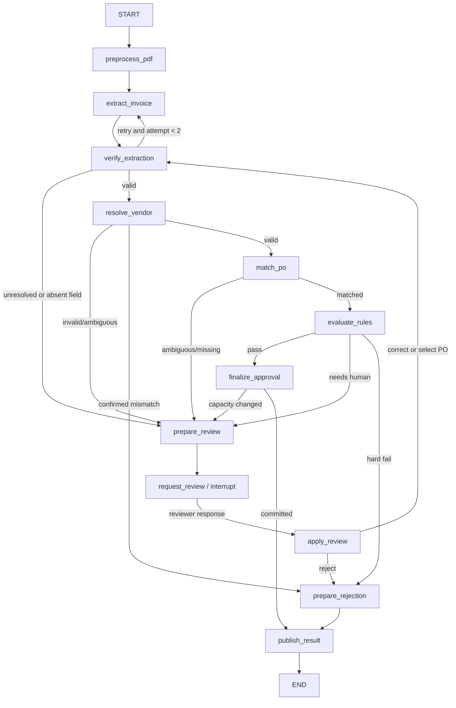

# PS-1 — LangGraph Workflow Design (v1.0 draft)

**Status:** architecture-first design. No production code yet. Goal: dependable human-in-the-loop invoice processing with one OpenAI provider, explicit failures and durable state.

## 1. Responsibility boundaries

- **FastAPI:** authenticate clients, intake PDFs, create/run/query/review jobs, return HTTP/SSE payloads.
- **Worker:** claim durable queue tasks, invoke or resume the graph; never make financial decisions.
- **LangGraph:** sequence nodes, route exceptions, pause/resume for people, hold checkpointable run state.
- **OpenAI extractor:** read invoice content using Responses API + Structured Outputs. No tools that execute business actions; any instructions found in a PDF are untrusted data.
- **Python services:** PDF inspection, field verification, vendor/PO matching, arithmetic, policy evaluation, atomic financial commit.
- **PostgreSQL:** source of truth for master data, runs, approval ledger, immutable review actions, checkpoint state, and event stream.

## 2. State contract: `InvoiceGraphStateV1`

Keep state JSON-serializable; use IDs and references for documents, not PDF contents or database sessions.

```text
run_id: UUID
thread_id: UUID                          # equal to run_id for MVP
file_sha256: str
document_uri: str
policy_version: str
prompt_version: str
extraction_schema_version: str
extraction_attempt: int                 # 0, 1, 2 only
extraction_model: str?
input_mode: TEXT | PDF_MULTIMODAL | VISUAL?
preprocessing: {page_count, text_coverage, warnings[]}
extracted_invoice: ExtractedInvoiceV1?
verification: {findings[], critical_fields_reliable: bool}
resolved_vendor_id: UUID?
po_candidates: [{po_id, match_reasons[]}]
selected_po_id: UUID?
rule_findings: RuleFinding[]
review_request_id: UUID?
review_answer: {action, payload, actor_id}?
decision: APPROVED | NEEDS_REVIEW | REJECTED | null
reason_codes: str[]
result_id: UUID?
terminal_error: {code, safe_message, retryable}?
```

The graph's state is *not* the run-events table. Run events are append-only, queryable independent records for the UI. A node emits events using an idempotent `(run_id, stage, attempt, event_code)` key; graph replay must not duplicate events.

## 3. Graph nodes and routing

| Node | Inputs | Outputs / side effects | Next |
|---|---|---|---|
| `preprocess_pdf` | URI | Page count, text layer, pages needing vision; event | `extract_invoice` |
| `extract_invoice` | PDF/text, prompt version, model policy | OpenAI Structured Output, token usage record, extraction event | `verify_extraction` |
| `verify_extraction` | Extracted schema and PDF evidence | Arithmetic, critical fields, evidence findings | `extract_invoice` if targeted retry remains; otherwise `resolve_vendor` or `request_review` |
| `resolve_vendor` | Supplier fields, master data | Verified vendor ID or mismatch findings | `match_po` or `request_review`/`prepare_rejection` |
| `match_po` | Vendor, reference, PO list | One explicit match or candidate list | `evaluate_rules` or `request_review` |
| `evaluate_rules` | PO, invoice, policy snapshot | RuleFinding array and provisional verdict | `finalize_approval`, `request_review`, or `prepare_rejection` |
| `prepare_review` | Actionable question + options | Idempotently persist review request; emit `REVIEW_REQUESTED` | `request_review` |
| `request_review` | Persisted review request ID | Only call `interrupt()` with JSON-serializable request payload; no non-idempotent writes before it | Resume with authorized answer via `apply_review` |
| `apply_review` | Human action | Validate reviewer action, apply selected PO/correction as explicit review override, event | Re-enter `verify_extraction`/`match_po`/`evaluate_rules`, or `prepare_rejection` |
| `finalize_approval` | Verified decision and PO | **Single atomic idempotent DB transaction**: lock PO, recompute balance, insert canonical invoice/ledger, update committed totals | `publish_result`; if changed balance -> review |
| `prepare_rejection` | Definitive policy violation | Write deterministic rejection reasons; no financial mutation | `publish_result` |
| `publish_result` | Finalized result | Mark `COMPLETED`; provide payment-ready export or draft reason; emit final event | `END` |
| `handle_technical_error` | Non-business exception | Persist safe fault context, mark `FAILED` after retry policy | `END` |

To prevent loops: every model call increments `extraction_attempt`; max 2 across Luna and Terra. A human may return a corrected field or PO choice, but reviewer answers cannot loop forever; cap total review cycles (proposal: 3) before requiring manual administrative handling.

## 4. Primary graph



## 5. Human review / checkpoint behavior

- Compile graph with a Postgres-backed LangGraph checkpointer and supply `configurable.thread_id=run_id` on every invoke/resume.
- **Fixed v1 design:** `prepare_review` idempotently persists the question and `REVIEW_REQUESTED` event. `request_review` only calls `interrupt()` with JSON-serializable `{review_request_id, question, options, reason_codes}`; no database writes before the interrupt. LangGraph may re-execute an interrupted node on resume.
- On resume, `apply_review` validates the previously persisted `review_actions` row. Both the review request and the reviewer action have idempotency keys.
- The POST review endpoint does **not** execute the graph inline. It saves an authenticated action and enqueues a `RESUME` task; worker loads same thread checkpoint and invokes `Command(resume=...)`.
- After selecting a PO or editing a critical field, rerun all affected deterministic validations. Never continue straight to approval.
- A `REQUEST_INFO` response can leave the case pending or lead to a new review request; no email is sent automatically.

## 6. Worker and recovery design

**MVP constraint:** one API service and one async worker loop can share a deployed service only if that host guarantees a continuously running process; configure a **single worker instance** initially. Do not rely on `BackgroundTasks` alone for durable jobs.

1. `POST /invoices/process` stores PDF and a `QUEUED` run in one durable transaction; enqueue `PROCESS` task.
2. Worker claims one due task using PostgreSQL row locks and `SKIP LOCKED`, writing `lease_until`, then invokes graph with `thread_id=run_id`.
3. Worker emits events, stores OpenAI usage, and renews lease during work. A crash leaves a reclaimable task after lease expiry.
4. When graph interrupts, job state becomes `WAITING_REVIEW` and task becomes `WAITING` rather than failed.
5. Reviewer submits action; API persists review action and new `RESUME` queue task.
6. Worker invokes graph `Command(resume=action_payload)` on same thread ID. Idempotent node operations and the ledger transaction prevent duplicate writes on replay.
7. API outage/restart: startup recovery scans expired leases and `QUEUED` tasks; terminal decisions are never rerun without a new explicit `reevaluate` job.

Backoff transient OpenAI/network errors (suggested 2 infrastructure retries on top of the one extraction-quality retry). Distinguish network retry of a request from a new extraction attempt; log each actual billed API call. Do not blindly auto-retry uncertain financial commit outcomes; re-read the ledger first.

## 7. Input and model strategy

- Inspect PDF locally with PyMuPDF and record whether machine-readable text is usable. Use a *benchmark*, not intuition, to choose between text-only and native PDF multimodal input.
- Baseline models: `gpt-6-luna` primary, `gpt-6.1-terra` escalation candidate; single `OPENAI_API_KEY`.
- OpenAI Responses API + Pydantic Structured Outputs. Structured schemas constrain shape; they do not guarantee factual correctness.
- Fixed instruction prefix, versioned prompts and stable output schema. Extract directly; do not generate analysis or final approval recommendation.
- On extraction verification failure, retry **only once** with localized failing fields and relevant page/evidence or escalate to Terra (benchmark determines choice).
- Collect per-call `input_tokens`, `cached_input_tokens`, `output_tokens`, latency, model, and estimated USD based on a dated pricing snapshot; handle missing usage fields explicitly.
- Never forward vendor secrets, app configuration, or internal database details in the model prompt. Demo uses synthetic vendor data.

## 8. Event envelope and examples

```json
{
  "event_id":"uuid",
  "run_id":"uuid",
  "seq":9,
  "type":"STAGE_FINISHED",
  "stage":"VERIFYING",
  "timestamp":"2026-11-11T10:00:05Z",
  "payload":{"outcome":"WARN","code":"AMOUNT_MISMATCH","safe_summary":"Invoice gross does not equal net plus tax"}
}
```

Stable event types: `RUN_QUEUED`, `STAGE_STARTED`, `STAGE_FINISHED`, `MODEL_CALL_RECORDED`, `REVIEW_REQUESTED`, `REVIEW_SUBMITTED`, `RUN_COMPLETED`, `RUN_FAILED`. No raw PDF text, full account number, or OpenAI key in event payloads. The dashboard reads these records, not model-generated progress text.

## 9. Security and demo reliability

- Accept synthetic PDFs for development and the interview. Validate MIME signature, page count, encrypted documents, max upload size, and storage access.
- No public review or policy change routes. Single reviewer auth is sufficient for case-study MVP; secrets live in environment variables.
- Demonstrate a live OpenAI call normally. An optional labeled replay fixture may be used only as an explicitly disclosed failure fallback, not to masquerade as live execution.
- Health endpoint, startup DB migration checks, container auto-restart, and one rehearsed happy path plus 3–4 edge cases are mandatory before demo.

## 10. Deferred architecture

No vector DB, Redis, agent swarm, email webhook, actual email send, ERP writes, goods-receipt validation, or distributed multi-worker scaling for MVP. A queue abstraction allows later migration to Celery/Temporal without rewriting the business rules or LangGraph nodes.

## References (checked 2026-11-11)

- LangGraph interrupts: https://docs.langchain.com/oss/python/langgraph/interrupts
- LangGraph persistence: https://docs.langchain.com/oss/python/langgraph/persistence
- OpenAI file inputs: https://developers.openai.com/api/docs/guides/file-inputs
- OpenAI Structured Outputs: https://developers.openai.com/api/docs/guides/structured-outputs
